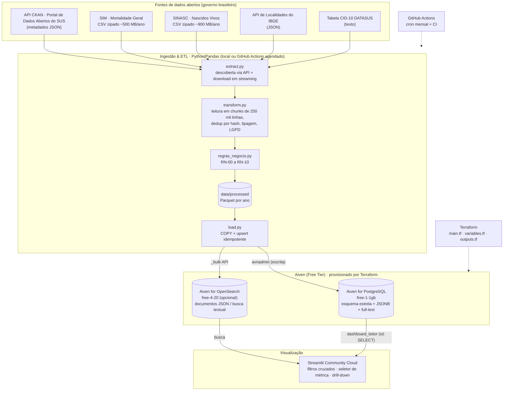

# Painel Epidemiológico de Mortalidade Materna e Violência Obstétrica

> Projeto Prático · Big Data e Analytics
> Pipeline de engenharia, governança e análise de Big Data em nuvem a custo zero (Aiven Free Tier),
> com análise interseccional de **raça/cor × idade × território** sobre a saúde de mulheres gestantes
> e puérperas no Brasil. Alinhado à **ODS 5 (Igualdade de Gênero)** e à **ODS 18 (Igualdade Étnico-Racial)**.

| Item | Onde |
|---|---|
| Código do ETL (extração, limpeza, regras de negócio, carga) | [`etl/`](etl/) |
| Infraestrutura como Código (Terraform + Aiven) | [`terraform/`](terraform/) |
| Dashboard interativo (Streamlit) | [`dashboard/`](dashboard/) |
| Agendamento / CI | [`.github/workflows/`](.github/workflows/) |
| Dashboard online | **<https://painel-mortalidade-materna-wxkg6vbjkxbndxteouxuyc.streamlit.app/>** |
| Base de dados tratada (Parquet + CSV + manifesto) | [`dados_tratados/`](dados_tratados/) |
| Documentos das entregas (PDF) | [`docs/`](docs/) |

### Entrega do Marco 2: onde está cada item

| Entregável | Onde encontrar |
|---|---|
| 1. Base de dados tratada | [`dados_tratados/`](dados_tratados/) · origem e versão original na [seção 3](#3-dados-utilizados) · decisões na [seção 7](#7-tratamento-realizado-problemas-decisões-e-justificativas) |
| 2. Processo de tratamento | [`etl/`](etl/) · [seção 8](#8-processo-de-ingestão-e-etl) (etapas) · [seção 11](#11-regras-de-negócio) (regras) |
| 3. Base armazenada em banco | Aiven for PostgreSQL + OpenSearch · estrutura, tipos e relacionamentos nas [seções 9 e 10](#9-modelagem-e-justificativa-da-escolha-dos-bancos) · quantidade armazenada na [seção 9](#quantidade-de-dados-armazenados) |
| 4. Infraestrutura (Terraform) | [`terraform/`](terraform/) · [seção 12](#12-infraestrutura-terraform--aiven) |
| 5. Segurança das informações | [seção 13](#13-segurança-da-informação) · [`.gitignore`](.gitignore) · varredura gitleaks em [`ci.yml`](.github/workflows/ci.yml) |
| 6. Repositório organizado | estrutura de diretórios na [seção 2](#estrutura-do-repositório) |
| 7. Documentação | este README · execução passo a passo na [seção 15](#15-execução-e-reprodução-deployment-guide) |
| Banco com a carga realizada | 694.410 linhas, 158 MB (15% de 1 GB), carga de 07/11/2026 |

---

## Sumário
1. [Entendimento do negócio e escopo](#1-entendimento-do-negócio-e-escopo)
2. [Arquitetura da solução](#2-arquitetura-da-solução)
3. [Dados utilizados](#3-dados-utilizados)
4. [Análise dos 5 V's](#4-análise-dos-5-vs-aplicada-ao-dataset)
5. [Classificação dos tipos de dados](#5-classificação-dos-tipos-de-dados)
6. [Aspectos legais: LGPD e dados abertos](#6-aspectos-legais-lgpd-e-dados-abertos)
7. [Tratamento realizado](#7-tratamento-realizado-problemas-decisões-e-justificativas)
8. [Processo de ingestão e ETL](#8-processo-de-ingestão-e-etl)
9. [Modelagem e escolha dos bancos](#9-modelagem-e-justificativa-da-escolha-dos-bancos)
10. [Dicionário de dados](#10-dicionário-de-dados)
11. [Regras de negócio](#11-regras-de-negócio)
12. [Infraestrutura (Terraform + Aiven)](#12-infraestrutura-terraform--aiven)
13. [Segurança da informação](#13-segurança-da-informação)
14. [Dashboard](#14-dashboard-dinâmico)
15. [Execução e reprodução (Deployment Guide)](#15-execução-e-reprodução-deployment-guide)
16. [Roteiro do pitch (10 min)](#16-roteiro-sugerido-para-o-pitch-de-10-minutos)
17. [Limitações e referências](#17-limitações-e-referências)

---

## 1. Entendimento do negócio e escopo

**Problema.** A morte materna é considerada evitável em mais de 90% dos casos. O Brasil se comprometeu
a reduzir a Razão de Mortalidade Materna (RMM) para 30 óbitos por 100 mil nascidos vivos até 2030
(ODS 3.1, meta nacional), mas a média nacional segue bem acima disso e **a desigualdade não é distribuída
ao acaso**: mulheres pretas e indígenas morrem mais, em todas as regiões. A violência obstétrica (práticas
desnecessárias, negligência, desassistência) é parte do mesmo problema, mas não tem um campo próprio nos
sistemas oficiais, então precisa ser observada por **indicadores indiretos (proxies)** de assistência.

**Pergunta interseccional central:** *como o risco de morte materna e a qualidade da assistência ao
pré-natal e ao parto variam quando se cruzam gênero, raça/cor, idade e território?*

Perguntas analíticas que o painel responde:

| # | Pergunta | Métrica(s) |
|---|---|---|
| P1 | Quanto maior é o risco de morte materna de mulheres pretas e indígenas em relação às brancas? | RMM por raça/cor, risco relativo (RN-03, RN-09) |
| P2 | O risco racial é igual em todas as regiões e anos (inclusive na pandemia)? | Heatmap de RR região × ano |
| P3 | Adolescentes e mulheres 40+ de cada raça/cor têm riscos diferentes? | Heatmap raça/cor × faixa etária |
| P4 | Onde estão as cesáreas eletivas em gestações de baixo risco e o pré-natal inadequado? | Proxies de violência obstétrica (RN-07) com drill-down até o município |
| P5 | Do que morrem as gestantes e como isso muda por raça/cor? | Treemap de causas, perfil assistencial (RN-02, RN-06) |
| P6 | Qual o peso das agressões e da morte materna entre mulheres em idade fértil, comparadas aos homens? | Óbitos 10–49 anos por sexo × raça/cor (RN-04) |

**Valor gerado.** Gestores municipais/estaduais e comitês de mortalidade materna conseguem localizar onde
e para quem a assistência falha, priorizando territórios e grupos com sobre-risco. Também serve para
controle social e pesquisa.

**Escopo.** 2019–2024 (bases consolidadas mais recentes; 2025 é preliminar e fica fora por padrão).
Brasil inteiro, por município de residência.

---

## 2. Arquitetura da solução



Fluxo em uma frase: **a API CKAN diz onde estão os arquivos → o ETL baixa e processa em lotes, aplicando
as regras de negócio → só agregados e registros anonimizados chegam ao PostgreSQL (e ao OpenSearch) →
o Streamlit consulta o banco com um usuário somente leitura.**

### Estrutura do repositório

```
├── etl/                     # PROCESSO DE TRATAMENTO (Python + Pandas)
│   ├── config.py            # parâmetros e leitura de credenciais do ambiente
│   ├── dominios.py          # tabelas de código (raça/cor, faixas, escolaridade, grupos de causa…)
│   ├── extract.py           # API CKAN, IBGE, CID-10, download em streaming com SHA-256
│   ├── transform.py         # leitura em chunks, deduplicação, limpeza e agregação (SIM e SINASC)
│   ├── regras_negocio.py    # conversão de tipos e regras RN-00…RN-10 (funções testadas)
│   ├── load.py              # DDL, COPY no PostgreSQL, GRANTs, controle de volume, OpenSearch
│   ├── pipeline.py          # orquestrador (CLI)
│   ├── exportar_base_tratada.py  # exporta o banco para dados_tratados/
│   ├── sql/schema.sql       # esquema estrela (tabelas, chaves, CHECKs, índices)
│   ├── sql/views.sql        # regras de negócio em SQL (RMM, risco relativo, indicadores)
│   └── tests/               # 25 testes unitários das regras (pytest)
├── terraform/               # INFRAESTRUTURA COMO CÓDIGO (Aiven)
│   ├── main.tf              # providers, PostgreSQL, banco, usuário leitor, OpenSearch, .env
│   ├── variables.tf         # variáveis (token marcado como sensitive)
│   ├── outputs.tf           # saídas (URIs com senha marcadas como sensitive)
│   ├── terraform.tfvars.example  # modelo, sem valores reais
│   └── .terraform.lock.hcl  # versões fixas dos providers
├── dados_tratados/          # BASE TRATADA: fatos em Parquet, dimensões em CSV, manifesto SHA-256
├── dashboard/               # VISUALIZAÇÃO (Streamlit)
│   ├── app.py               # aplicação Streamlit (6 abas)
│   ├── dados.py             # consultas SQL parametrizadas + busca OpenSearch
│   ├── metricas.py          # catálogo de métricas e paleta de cores
│   └── requirements.txt
├── docs/                    # DOCUMENTAÇÃO das entregas em PDF
├── .github/workflows/
│   ├── etl.yml              # ETL agendado (batch mensal, incremental)
│   └── ci.yml               # testes, terraform validate, varredura de segredos (gitleaks)
├── .streamlit/              # tema do painel + modelo de secrets (sem valores reais)
├── .env.example             # modelo de variáveis de ambiente (sem segredos)
├── .gitignore               # bloqueia .env, tfstate, tfvars, secrets e microdados brutos
├── README.md                # esta documentação
└── requirements.txt         # dependências do ETL
```

---

## 3. Dados utilizados

### Fonte e identificação da base

| Base | Conteúdo | Identificação | Formato |
|---|---|---|---|
| **SIM** – Sistema de Informação sobre Mortalidade | 1 linha por óbito, ~90 colunas | Conjunto `sim` no [Portal de Dados Abertos do SUS](https://dadosabertos.saude.gov.br), recurso "Mortalidade Geral AAAA" | CSV `;` latin-1 em .zip |
| **SINASC** – Sistema de Informação sobre Nascidos Vivos | 1 linha por nascimento, ~60 colunas | Conjunto `sistema-de-informacao-sobre-nascidos-vivos-sinasc`, recurso "Nascidos Vivos - AAAA" | CSV `;` latin-1 em .zip |
| API de Localidades do IBGE | 5.571 municípios, UFs e regiões | `servicodados.ibge.gov.br/api/v1/localidades/municipios` | JSON |
| Tabela CID-10 do DATASUS | 12.451 subcategorias com descrição | `CID10CSV.zip` (versão 2008) | CSV em .zip |

Publicador: Ministério da Saúde. Licença: Creative Commons Atribuição (CC-BY). Os arquivos são localizados
pela API CKAN do portal (`package_show`), sem links fixos no código.

### Período e recorte

* **Período:** 2019 a 2024, as seis bases consolidadas mais recentes. 2025 é publicada como "preliminar" e
  fica fora por padrão, porque óbitos ainda em investigação mudam de causa depois.
* **Território:** Brasil inteiro, por município de residência.
* **Escopo:** todos os nascidos vivos (denominador), todas as mortes maternas (numerador) e os óbitos de
  pessoas de 10 a 49 anos (comparação de gênero). Os demais óbitos são lidos, mas não armazenados.

### Características relevantes da base

* **Volume:** 25.021.734 linhas (9.276.519 óbitos e 15.745.215 nascimentos), ~1,2 GB compactado e ~8 GB
  descompactado, frente a um banco gratuito de 1 GB.
* **Tudo é texto codificado:** raça/cor, sexo, local e tipo de parto chegam como códigos (`1`, `2`, `9`…) que
  só têm significado com os dicionários oficiais. A idade do SIM é um código de 3 dígitos (`425` = 25 anos).
* **Informação ignorada é comum:** raça/cor da mãe ausente em 2,8% dos nascimentos, por exemplo.
* **Campos semiestruturados:** a cadeia de causas do atestado de óbito vem como `*O149*R571` em cinco colunas.
* **Dados sensíveis:** dados de saúde são dados pessoais sensíveis pela LGPD, mesmo anonimizados na origem.
* **A base muda:** o Ministério republica os arquivos quando revisa óbitos investigados (o SIM 2022 e 2023
  foi republicado em 29/10/2026), por isso cada carga registra a versão usada.

### Versão original utilizada

Data de publicação informada pela API e hash SHA-256 calculado no download, gravados em `etl_execucao` e em
[`dados_tratados/controle/`](dados_tratados/controle/versao_fontes_e_qualidade.json).

| Sistema | Ano | Arquivo | Publicado em | SHA-256 (início) | Linhas |
|---|---|---|---|---|---:|
| SIM | 2019 | `Mortalidade_Geral_2019_csv.zip` | 14/09/2026 | `66501b7348ad77d8` | 1.349.801 |
| SIM | 2020 | `Mortalidade_Geral_2020_csv.zip` | 14/09/2026 | `ac626dff18876eaa` | 1.556.824 |
| SIM | 2021 | `Mortalidade_Geral_2021_csv.zip` | 14/09/2026 | `6a8fe8077cf11cbf` | 1.832.649 |
| SIM | 2022 | `Mortalidade_Geral_2022_csv.zip` | 29/10/2026 | `b8fb61ab39b2408b` | 1.544.266 |
| SIM | 2023 | `Mortalidade_Geral_2023_csv.zip` | 29/10/2026 | `4409b41e945506fb` | 1.465.610 |
| SIM | 2024 | `Mortalidade_Geral_2024_csv.zip` | 11/11/2025 | `a68437fc88d7e3be` | 1.527.369 |
| SINASC | 2019 | `SINASC_2019_csv.zip` | 08/05/2026 | `4d528a8b6338ac3d` | 2.849.146 |
| SINASC | 2020 | `SINASC_2020_csv.zip` | 08/05/2026 | `d06af4961ab021cf` | 2.730.145 |
| SINASC | 2021 | `SINASC_2021_csv.zip` | 08/05/2026 | `240eb1f03aa9cb5e` | 2.677.101 |
| SINASC | 2022 | `SINASC_2022_csv.zip` | 08/05/2026 | `89e6f791a2470588` | 2.561.922 |
| SINASC | 2023 | `SINASC_2023_csv.zip` | 08/05/2026 | `c4ce57f7aa539023` | 2.537.576 |
| SINASC | 2024 | `SINASC_2024_csv.zip` | 08/05/2026 | `27e55de6359e1b19` | 2.389.325 |

---

## 4. Análise dos 5 V's aplicada ao dataset

| V | Como aparece neste projeto | Decisão de engenharia |
|---|---|---|
| **Volume** | 6 anos × (SIM ≈ 1,35–1,8 milhão de óbitos/ano + SINASC ≈ 2,4–2,8 milhões de nascimentos/ano) ≈ **25 milhões de registros**, ~8 GB de CSV descompactado (≈ 1,2 GB zipado). O PostgreSQL gratuito tem **1 GB**. | Leitura **em chunks direto do .zip** (nunca descompacta em disco), seleção só das colunas necessárias e **agregação no ETL** (grão ano × município × raça/cor × faixa etária). Resultado: o banco inteiro ocupa 158 MB (15% do limite). `load.verificar_tamanho()` mede o banco a cada carga e alerta acima de 80%. Amostragem controlada opcional (`ETL_AMOSTRA`) para testes rápidos. |
| **Variedade** | CSV tabular (SIM/SINASC), JSON da API CKAN e da API do IBGE, campos multivalorados codificados em texto (`*O149*R571`), descrições textuais da CID-10. | Cada formato tem um tratamento próprio (seção 5). JSON de metadados vai para coluna **JSONB**; a cadeia de causas vira **JSONB** e documento aninhado no **OpenSearch**; texto vira índice **full-text**. |
| **Velocidade** | As bases são publicadas uma vez por ano e **revisadas** ao longo do tempo (óbitos investigados mudam de causa). | Processamento em **lote (batch)** agendado no GitHub Actions (todo dia 5). Modo `--incremental` compara o `last_modified` do recurso na API CKAN com a última carga e só reprocessa o que mudou. Carga idempotente por ano. |
| **Veracidade** | Campos ignorados (raça/cor da mãe ignorada em 1,9% a 3,5% dos nascimentos, conforme o ano), códigos fora do dicionário, municípios inexistentes, linhas duplicadas, bases preliminares. | Deduplicação por hash entre chunks, normalização de códigos (inválido → "9 Ignorado"), validação do município contra o IBGE, rejeição de bases preliminares, **denominadores válidos** por indicador, `CHECK`s no banco (numerador ≤ denominador), relatório de qualidade por execução gravado em `etl_execucao` e exibido no painel. |
| **Valor** | Indicadores interseccionais acionáveis: RMM e risco relativo por raça/cor, proxies de violência obstétrica, causas evitáveis. | 4+ KPIs principais, 17 métricas selecionáveis, drill-down até o município (ver seção 14). |

Volumes reais processados (saída do ETL):

| Ano | Óbitos lidos (SIM) | Nascidos vivos (SINASC) | Óbitos maternos (RMM) | Óbitos maternos tardios | RMM Brasil |
|---|---:|---:|---:|---:|---:|
| 2019 | 1.349.801 | 2.849.118 | 1.563 | 165 | 54,9 |
| 2020 | 1.556.824 | 2.730.129 | 1.965 | 182 | 72,0 |
| 2021 | 1.832.649 | 2.677.087 | 3.029 | 379 | 113,1 |
| 2022 | 1.544.266 | 2.561.906 | 1.370 | 270 | 53,5 |
| 2023 | 1.465.610 | 2.537.554 | 1.324 | 280 | 52,2 |
| 2024 | 1.527.369 | 2.389.316 | 1.305 | 248 | 54,6 |
| **Total** | **9.276.519** | **15.745.110** | **10.556** | **1.524** | **67,0** |

Deduplicação: 112 linhas repetidas removidas no SIM e 105 no SINASC. Nenhum registro precisou ser descartado
por residência inválida; ~2.500 óbitos/ano tinham município inexistente e foram reatribuídos ao
"município ignorado" da UF (RN-08).

Resultado no banco: `fato_saude_materna` 591.526 linhas (126 MB com índices), `fato_obito_materno` 12.080
linhas (13 MB), `fato_obito_idade_reprodutiva` 70.885 linhas (8 MB). **Banco total: 158 MB = 15% do limite
de 1 GB.** Tempo de processamento: ~3 min por ano.

### Principais achados (2019–2024, Brasil)

* **Desigualdade racial persistente na morte materna.** RMM de mulheres **indígenas: 121,9** e **pretas:
  113,5** por 100 mil nascidos vivos, contra **63,8 das brancas** — risco relativo de **1,91×** e **1,78×**.
* **A pandemia agravou a desigualdade.** Em 2021 a RMM nacional chegou a 113,1 (o dobro de 2019). Entre
  mulheres pretas foi a 195,9.
* **Duas faces da violência obstétrica.** Mulheres **brancas** têm mais cesáreas eletivas em gestações de
  baixo risco (30,5%, contra 18,2% das pretas e 5,5% das indígenas), sinal de **excesso de intervenção**.
  Mulheres **pretas, pardas e indígenas** têm mais **pré-natal inadequado** (20,8%, 19,8% e 38,9%, contra
  12,0% das brancas) e mais **óbitos sem assistência médica**, sinal de **desassistência**. Entre indígenas,
  16,9% dos partos acontecem fora de estabelecimento de saúde.
* **Gênero e violência.** 18.155 mulheres de 10 a 49 anos foram mortas por agressão no período (70% delas
  negras); **528 estavam grávidas ou no puerpério**.
* **Causas evitáveis.** Entre as causas obstétricas diretas, as síndromes hipertensivas (1.875 óbitos) e as
  hemorragias (1.074) lideram: ambas são evitáveis com pré-natal e assistência ao parto adequados.

---

## 5. Classificação dos tipos de dados

| Dado | Tipo | Origem / formato | Tratamento |
|---|---|---|---|
| Microdados do SIM e do SINASC | **Estruturado** | CSV `;` (latin-1) dentro de .zip | Pandas em chunks → tabelas fato relacionais |
| Metadados dos conjuntos de dados (licença, datas de modificação, URLs) | **Semi-estruturado** | JSON da API CKAN (`package_show`) | Guardado em `data/raw/metadata/*.json` e na coluna `etl_execucao.fonte` (**JSONB**); usado no modo incremental |
| Municípios, UFs e regiões | **Semi-estruturado** | JSON da API de Localidades do IBGE | Normalizado em `dim_localidade` |
| Cadeia de causas da Declaração de Óbito (linhas A, B, C, D e parte II) | **Semi-estruturado** | Texto com padrão (`*O159*R571`), multivalorado | Convertido para lista de CIDs (RN-05) → coluna **JSONB** com índice GIN e objeto aninhado no OpenSearch |
| Descrições das causas (CID-10) | **Não estruturado** (texto livre em português) | CSV do DATASUS | Concatenadas em `texto_causas` → índice **full-text** (`tsvector` português sem acentos) e campo `text` com analisador `brazilian` no OpenSearch |
| Dicionário de dados do SIM (PDF) | **Não estruturado** | PDF publicado no CKAN | Usado como referência humana para os domínios em `dominios.py` |

---

## 6. Aspectos legais: LGPD e dados abertos

* **Licença:** SIM e SINASC são publicados no Portal de Dados Abertos do SUS sob **CC-BY** (atribuição),
  já **anonimizados** pelo Ministério da Saúde (sem nome, CPF, endereço ou número da declaração).
* **Base legal:** dados de saúde são **dados pessoais sensíveis** (LGPD art. 5º, II). O tratamento para
  estudo por órgão de pesquisa e para políticas públicas é previsto nos arts. 7º, IV; 11, II, "b" e "c";
  e o art. 7º, §§ 3º e 4º, permite tratar dados tornados públicos respeitando a finalidade e a boa-fé.
  Dados anonimizados não são dados pessoais (art. 12), **desde que a reidentificação não seja razoável**.
* **O que o projeto faz para reduzir o risco de reidentificação** (dados de saúde de pequenos municípios
  podem ser reidentificáveis por combinação de atributos):
  1. **Minimização (art. 6º, III):** das ~90 colunas do SIM e ~60 do SINASC, só as necessárias seguem no
     pipeline. Datas exatas (nascimento, óbito, cadastro), estabelecimento de saúde (CNES), ocupação,
     naturalidade e horário **só existem em memória** durante o cálculo do hash de deduplicação e são
     descartadas no mesmo bloco. **Nada disso é gravado.**
  2. **Generalização:** idade exata → faixa quinquenal; data → ano; nos registros individuais de óbito
     materno, município → **apenas UF**.
  3. **Agregação:** nascimentos e óbitos do município só existem como **contagens agregadas**.
  4. **Identificador não reversível:** `id_obito` é um hash de 64 bits da linha, não o número da DO.
  5. **Alerta de células pequenas:** o painel avisa quando o recorte tem menos de 20 óbitos e oculta, por
     padrão, municípios com menos de 1.000 nascidos vivos no drill-down.
* **Atribuição:** as fontes são citadas no painel e neste README.

---

## 7. Tratamento realizado: problemas, decisões e justificativas

A regra geral foi **não descartar registros válidos**: um nascimento ou óbito com um campo ruim continua
contado, e só aquele campo vira "Ignorado". Descartar linhas inteiras enviesaria justamente os grupos com
pior registro, que são os mais vulneráveis. Os números vêm do relatório de qualidade gravado a cada carga.

### Problemas encontrados na base

| Problema | Exemplo | Quantidade (2019–2024) |
|---|---|---|
| Linhas duplicadas | Mesma linha repetida no arquivo | 112 no SIM, 105 no SINASC |
| Raça/cor ignorada ou fora do dicionário | `RACACORMAE` vazio ou `9` | 445.202 nascimentos (2,8%) |
| Município de residência inexistente no IBGE | Código desativado ou digitado errado | 14.601 óbitos e 453 nascimentos |
| Idade em código | `IDADE = 425` significa 25 anos | Todas as linhas do SIM |
| Números fora da faixa plausível | Peso de 50 g, 60 semanas de gestação | Viram nulo no indicador afetado |
| Causas em texto multivalorado | `*O149*R571` em 5 colunas | Todos os óbitos |
| Colunas com dados sensíveis | Data exata, estabelecimento, ocupação | ~70 colunas do SIM, ~45 do SINASC |
| Volume maior que o banco | ~8 GB de CSV para 1 GB de banco | — |

### Decisões, transformações e justificativas

| Decisão / transformação | Justificativa | Impacto medido |
|---|---|---|
| Ler todas as colunas como texto e tipar depois | Evita que o Pandas transforme `01` em `1` ou em decimal | Nenhum código corrompido |
| Padronizar nomes em `snake_case` minúsculo | Mesmos nomes no Python, no SQL e na documentação | `DTOBITO` → `dtobito` |
| Remover duplicatas por hash de 64 bits, também entre blocos | Linhas idênticas inflariam as contagens; o hash compara blocos sem guardar tudo em memória | 217 linhas removidas |
| Manter só 20 colunas do SIM e 15 do SINASC | Minimização da LGPD (art. 6º, III) e redução de volume | Dados sensíveis nunca gravados |
| Código fora do dicionário → `9` (Ignorado) | Mantém o registro no total e torna a falta de informação visível no painel | Categoria "Ignorada" em todas as dimensões |
| Número fora da faixa plausível → nulo | É erro de digitação; o nulo sai só do denominador daquele indicador | Total de nascidos vivos preservado |
| Município inexistente → "município ignorado" da UF (`UU0000`) | O registro continua somando no estado e na região | Nenhum registro descartado |
| Decodificar `IDADE`, extrair o ano de `DDMMAAAA`, converter peso, semanas e Apgar para inteiro | Permite calcular faixas e indicadores | Tipos finais no dicionário (seção 10) |
| Transformar `*O149*R571` em lista JSON | Permite buscar e filtrar por qualquer causa do atestado | Coluna `JSONB` + documento no OpenSearch |
| Classificar a morte materna pela CID-10 (RN-02) | Definição da OMS: diretas, indiretas e não especificadas entram na RMM; tardias não | 10.556 óbitos maternos e 1.524 tardios |
| Usar o ano do arquivo e rejeitar bases preliminares | Padrão das estatísticas oficiais; dados em investigação distorcem a série | 0 registros com data de outro ano |
| Agregar em ano × município × raça/cor × faixa etária | Cabe em 1 GB, protege a privacidade e responde ao painel com `SUM` | 25 milhões de linhas → 591.526 |
| Generalizar os registros individuais de morte materna | Em municípios pequenos, data + idade + local poderiam identificar a mulher | Idade → faixa, data → ano, município → UF, número da declaração → hash |
| Não usar amostragem na carga final | Morte materna é rara (~1.760 por ano); amostrar perderia precisão por raça e UF | 100% dos registros |

A sequência técnica dessas transformações está na seção 8, e as regras de negócio na seção 11.

---

## 8. Processo de ingestão e ETL

```
python -m etl.pipeline --anos 2019-2024 [--incremental] [--aceitar-preliminar] [--sem-banco] [--sem-opensearch]
```

Para cada ano o orquestrador ([`etl/pipeline.py`](etl/pipeline.py)):

1. **Descobre** o recurso CSV do ano via `GET /api/3/action/package_show` (CKAN) e rejeita bases
   "preliminares" (salvo `--aceitar-preliminar`).
2. **Baixa** em streaming (blocos de 8 MB, retry exponencial, cache local por tamanho) e calcula SHA-256.
3. **Transforma** ([`etl/transform.py`](etl/transform.py)) lendo o CSV de dentro do zip em blocos de 250 mil
   linhas. Em cada bloco: padroniza nomes de colunas → remove duplicatas (hash 64 bits, também entre
   blocos) → amostragem opcional → descarta colunas não usadas (LGPD) → converte tipos e normaliza códigos
   → valida município → aplica as regras de negócio → agrega.
4. **Integra** SIM e SINASC na mesma fato (numerador e denominador da RMM lado a lado).
5. **Persiste** a camada *processed* em Parquet (`data/processed/<tabela>/ano=AAAA.parquet`).
6. **Carrega** no PostgreSQL numa transação por ano: `DELETE` do ano + `COPY` (idempotente).
7. **Registra** a execução e o relatório de qualidade em `etl_execucao` (JSONB).
8. Ao final: recria as views, aplica `GRANT SELECT` ao usuário do dashboard, mede o tamanho do banco e
   indexa os óbitos maternos no OpenSearch.

Desempenho medido (notebook comum): **~2,5 a 3 min por ano** (SIM + SINASC), com uso de memória limitado
pelo tamanho do chunk.

---

## 9. Modelagem e justificativa da escolha dos bancos

### Esquema estrela (PostgreSQL)

```mermaid
erDiagram
    dim_tempo ||--o{ fato_saude_materna : ano
    dim_localidade ||--o{ fato_saude_materna : cod_municipio
    dim_raca_cor ||--o{ fato_saude_materna : cod_raca_cor
    dim_faixa_etaria ||--o{ fato_saude_materna : cod_faixa_etaria

    dim_tempo ||--o{ fato_obito_materno : ano
    dim_raca_cor ||--o{ fato_obito_materno : cod_raca_cor
    dim_faixa_etaria ||--o{ fato_obito_materno : cod_faixa_etaria
    dim_escolaridade ||--o{ fato_obito_materno : cod_escolaridade
    dim_tipo_obstetrico ||--o{ fato_obito_materno : tipo_obstetrico
    dim_grupo_causa_materna ||--o{ fato_obito_materno : grupo_causa

    dim_tempo ||--o{ fato_obito_idade_reprodutiva : ano
    dim_sexo ||--o{ fato_obito_idade_reprodutiva : cod_sexo
    dim_raca_cor ||--o{ fato_obito_idade_reprodutiva : cod_raca_cor
    dim_faixa_etaria ||--o{ fato_obito_idade_reprodutiva : cod_faixa_etaria
    dim_grupo_causa_geral ||--o{ fato_obito_idade_reprodutiva : cod_grupo_causa

    fato_saude_materna {
        smallint ano PK
        char6 cod_municipio PK
        varchar cod_raca_cor PK
        varchar cod_faixa_etaria PK
        int nascidos_vivos
        int obitos_maternos
        int "22 outras medidas"
    }
    fato_obito_materno {
        text id_obito PK
        smallint ano
        char2 cod_uf
        varchar causa_basica
        jsonb cadeia_causas
        tsvector tsv_causas
    }
    fato_obito_idade_reprodutiva {
        smallint ano PK
        char2 cod_uf PK
        varchar cod_sexo PK
        text cod_grupo_causa PK
        int n_obitos
    }
```

Três fatos com grãos diferentes, cada um respondendo a um tipo de pergunta:

| Fato | Grão | Para quê |
|---|---|---|
| `fato_saude_materna` | ano × município × raça/cor × faixa etária | RMM e todos os indicadores obstétricos, drill-down territorial |
| `fato_obito_materno` | 1 linha por morte materna (anonimizada) | Causas, perfil assistencial, busca textual |
| `fato_obito_idade_reprodutiva` | ano × UF × sexo × raça/cor × faixa × grupo de causa | Comparação de gênero (homens × mulheres) |

Otimizações para **Veracidade** e **leitura**: chaves primárias compostas (impedem duplicação), chaves
estrangeiras para todas as dimensões, `CHECK`s de consistência (numerador ≤ denominador), coluna gerada
`cod_uf` indexada, índices compostos `(cod_uf, ano)` e `(cod_raca_cor, ano)`, índice **GIN** em JSONB
(`jsonb_path_ops`) e em `tsvector`.

### Por que relacional **e** não relacional?

| Critério | PostgreSQL (relacional) | OpenSearch (não relacional) |
|---|---|---|
| Natureza do dado | Fatos e dimensões com estrutura fixa e chaves bem definidas | Documentos JSON com listas aninhadas (cadeia de causas) e texto livre |
| Consulta típica | `SUM` + `GROUP BY` com filtros combinados (razões, taxas) | Busca por palavra ("hemorragia", "eclâmpsia") com relevância e agregação por facetas |
| Integridade | FKs, PKs, `CHECK`s, transações ACID → **Veracidade** | Esquema flexível; consistência eventual é aceitável para busca |
| Free tier Aiven | `free-1-1gb` (1 GB) — cabe com folga após agregação | `free-4-20` |
| Papel no projeto | **Fonte da verdade** de todas as métricas | **Índice de busca** derivado do PostgreSQL (pode ser recriado a qualquer momento) |

O OpenSearch é **opcional** (como no guia): `habilitar_opensearch = false` no Terraform desliga o serviço
e o painel passa a usar a busca full-text do próprio PostgreSQL (`tsvector`), sem perder funcionalidade.

### Quantidade de dados armazenados

Contagem com `COUNT(*)` e tamanho com `pg_total_relation_size` (dados + índices) no Aiven for PostgreSQL,
após a carga de 07/11/2026. **Total: 158 MB, 15% do limite de 1 GB.**

| Tabela | Tipo | Linhas | Tamanho |
|---|---|---:|---:|
| `fato_saude_materna` | fato | 591.526 | 125,7 MB |
| `fato_obito_materno` | fato | 12.080 | 12,7 MB |
| `fato_obito_idade_reprodutiva` | fato | 70.885 | 7,8 MB |
| `dim_cid10` | dimensão | 14.236 | 1,9 MB |
| `dim_localidade` | dimensão | 5.598 | 0,7 MB |
| Outras 9 dimensões | dimensão | 73 | 0,2 MB |
| `etl_execucao` | controle | 12 | 0,1 MB |
| **Total PostgreSQL** | | **694.410** | **158 MB** |
| Índice `obitos-maternos` (OpenSearch) | documentos | 12.080 | 3,8 MB |

Essas linhas contêm, agregados, todos os 15.745.110 nascidos vivos e todos os óbitos do escopo.
A mesma base está exportada em [`dados_tratados/`](dados_tratados/).

---

## 10. Dicionário de dados

Esquema `saude_materna`. Códigos seguem os dicionários oficiais do SIM e do SINASC.

### `fato_saude_materna`

| Coluna | Tipo | Origem | Descrição |
|---|---|---|---|
| `ano` | smallint | arquivo | Ano de registro (FK `dim_tempo`) |
| `cod_municipio` | char(6) | `CODMUNRES` | Município de residência, código IBGE sem dígito verificador (FK `dim_localidade`) |
| `cod_raca_cor` | varchar(1) | SIM `RACACOR` / SINASC `RACACORMAE` | Raça/cor da mulher (FK `dim_raca_cor`) |
| `cod_faixa_etaria` | varchar(5) | SIM `IDADE` / SINASC `IDADEMAE` | Faixa etária da mulher (FK `dim_faixa_etaria`) |
| `cod_uf` | char(2) | gerada | 2 primeiros dígitos do município (coluna gerada e indexada) |
| `nascidos_vivos` | int | SINASC | Total de nascidos vivos |
| `partos_info_valida` / `partos_cesareos` | int | `PARTO` | Partos com tipo informado / cesáreos |
| `robson_classificados` | int | `TPROBSON` | Nascimentos com grupo de Robson 1–10 |
| `robson1_total` / `robson1_cesareas` | int | `TPROBSON`, `PARTO` | Grupo 1 de Robson / cesáreas nesse grupo |
| `baixo_risco_total` | int | `TPROBSON` | Grupos 1 a 4 de Robson |
| `cesareas_eletivas_baixo_risco` | int | `TPROBSON`, `PARTO`, `STCESPARTO` | Cesárea antes do trabalho de parto nos grupos 1–4 |
| `prenatal_classificado` / `prenatal_inadequado` | int | `KOTELCHUCK` | Índice informado (1–5) / não realizou ou inadequado (1–2) |
| `consultas_info_valida` / `menos_7_consultas` | int | `CONSULTAS` | Faixa de consultas informada / menos de 7 consultas |
| `inicio_prenatal_valido` / `inicio_prenatal_tardio` | int | `MESPRENAT` | Mês de início informado / início após o 3º mês |
| `local_info_valida` / `partos_fora_estabelecimento` | int | `LOCNASC` | Local informado / domicílio ou outros |
| `apgar5_valido` / `apgar5_baixo` | int | `APGAR5` | Apgar informado / Apgar < 7 |
| `gestacao_valida` / `prematuros` | int | `SEMAGESTAC`, `GESTACAO` | Idade gestacional informada / < 37 semanas |
| `peso_valido` / `baixo_peso` | int | `PESO` | Peso plausível (300–6.500 g) / < 2.500 g |
| `obitos_maternos` | int | SIM | Mortes maternas que entram na RMM (RN-03) |
| `obitos_maternos_diretos` / `_indiretos` / `_tardios` | int | SIM | Por tipo obstétrico (RN-02) |
| `obitos_sem_assistencia` | int | `ASSISTMED` = 2 | Morte materna sem assistência médica |
| `obitos_fora_estabelecimento` | int | `LOCOCOR` ∈ {3,4,5} | Morte materna em domicílio, via pública ou outros |
| `obitos_investigados` | int | `FONTEINV` ∈ 1–8 | Morte materna investigada |

### `fato_obito_materno`

| Coluna | Tipo | Origem | Descrição |
|---|---|---|---|
| `id_obito` | text | hash | `ANO-hash64` da linha original (não reversível) |
| `ano`, `cod_uf` | | `CODMUNRES` | Ano e **UF** de residência (generalização LGPD) |
| `cod_raca_cor`, `cod_faixa_etaria`, `cod_escolaridade` | | `RACACOR`, `IDADE`, `ESC2010` | Perfil sociodemográfico |
| `causa_basica` / `causa_basica_descricao` | varchar(4) / text | `CAUSABAS` + CID-10 | Causa básica e descrição |
| `tipo_obstetrico` | text | RN-02 | direta, indireta, não especificada, tardia |
| `grupo_causa` | text | RN-02 | aborto, hipertensão, hemorragia, infecção… |
| `cod_momento_obito` | varchar(1) | `TPMORTEOCO` | Gravidez, parto, abortamento, até 42 dias… |
| `cod_local_ocorrencia` | varchar(1) | `LOCOCOR` | Hospital, domicílio, via pública… |
| `cod_assistencia_medica`, `cod_necropsia` | varchar(1) | `ASSISTMED`, `NECROPSIA` | Sim / Não / Ignorado |
| `investigado` | boolean | `FONTEINV` | Óbito investigado pela vigilância |
| `cadeia_causas` | **jsonb** | `LINHAA…LINHAII` | `{"a":["O159"],"b":["O149","R571"],"c":[],"d":[],"ii":[]}` |
| `texto_causas` | text | CID-10 | Descrições concatenadas (busca textual) |
| `tsv_causas` | tsvector (gerada) | | Índice full-text em português, sem acentos |

### `fato_obito_idade_reprodutiva`

| Coluna | Descrição |
|---|---|
| `ano`, `cod_uf`, `cod_sexo`, `cod_raca_cor`, `cod_faixa_etaria` | Dimensões (10 a 49 anos, sexo masculino/feminino) |
| `cod_grupo_causa` | Grupo de causa geral (RN-04) |
| `n_obitos` | Número de óbitos |
| `n_gestante_puerpera` | Óbitos de mulheres grávidas ou puérperas (`OBITOGRAV`=1 ou `OBITOPUERP`∈{1,2}) |

### Dimensões e controle

| Tabela | Conteúdo |
|---|---|
| `dim_tempo` | ano, período (pré-pandemia / pandemia / pós-pandemia), flag de base preliminar |
| `dim_localidade` | 5.571 municípios do IBGE + 27 linhas "Município ignorado – UF" |
| `dim_raca_cor` | 1 Branca, 2 Preta, 3 Amarela, 4 Parda, 5 Indígena, 9 Ignorada + `grupo_ibge` (Negra = Preta + Parda) |
| `dim_faixa_etaria` | <10, 10–14, 15–19, …, 45–49, 50+, IGN (com ordem) |
| `dim_escolaridade` | 0 Sem escolaridade … 5 Superior completo, 9 Ignorada |
| `dim_sexo` | 1 Masculino, 2 Feminino, 9 Ignorado |
| `dim_tipo_obstetrico` | tipo + `entra_rmm` |
| `dim_grupo_causa_materna` | grupo + descrição + intervalo de CIDs |
| `dim_grupo_causa_geral` | materna, COVID-19, agressão, suicídio, transporte, … |
| `dim_dominio` | domínios pequenos do SIM (momento do óbito, local de ocorrência, sim/não) |
| `dim_cid10` | ~14 mil códigos CID-10 com descrição |
| `etl_execucao` | log de cada carga: status, fração de amostra, `relatorio` (JSONB de qualidade), `fonte` (JSONB do CKAN) |

Views de negócio: `vw_fato_saude_materna`, `vw_rmm_uf_raca`, `vw_risco_relativo_racial`,
`vw_indicadores_obstetricos`, `vw_obito_materno_detalhado`, `vw_qualidade_ultima_carga`, `vw_uf`.

---

## 11. Regras de negócio

Todas implementadas em [`etl/regras_negocio.py`](etl/regras_negocio.py) (com testes em
[`etl/tests/`](etl/tests/)) e, para as métricas, também em SQL em [`etl/sql/views.sql`](etl/sql/views.sql).

| Código | Regra | Lógica |
|---|---|---|
| **RN-00** | Padronização e tipagem | Colunas em `snake_case` minúsculo; códigos fora do dicionário → `9` (Ignorado); texto → inteiro com faixa plausível (fora → nulo); `IDADE` do SIM decodificada (1º dígito = unidade: `4`=anos, `5`=100+); datas `DDMMAAAA` → ano |
| **RN-01** | Faixa etária | Idade em anos → faixas quinquenais 10–14 … 45–49, 50+, IGN |
| **RN-02** | Classificação da morte materna | Pré-condição: óbito não fetal e sexo feminino. **Direta:** O00–O92 (exceto indiretas) + A34; F53, M83, D39.2 e E23.0 só com vínculo gestacional declarado. **Indireta:** O10, O24 (exceto O24.4), O25, O98, O99. **Não especificada:** O95. **Tardia:** O96–O97. Grupos: aborto (O00–O08), hipertensão (O10–O16), hemorragia (O20, O44–O46, O67, O72), infecção (O85–O86) etc. |
| **RN-03** | **Razão de Mortalidade Materna** | `RMM = (diretas + indiretas + não especificadas) ÷ nascidos vivos × 100.000`. Tardias **não** entram. Sempre razão de somas, nunca média de razões. |
| **RN-04** | Grupo de causa geral (10–49 anos) | materna → COVID-19 (B34.2/U07) → agressão (X85–Y09) → suicídio (X60–X84) → transporte (V01–V99) → outras externas → neoplasias → circulatório → infecciosas → demais |
| **RN-05** | Cadeia de causas | `*O159*R571` → `["O159","R571"]` por linha da DO (A, B, C, D, II); sufixo `X` de 3 caracteres removido |
| **RN-06** | Assistência ao óbito materno | sem assistência (`ASSISTMED`=2); fora de estabelecimento (`LOCOCOR`∈{3,4,5}); investigado (`FONTEINV`∈1–8) |
| **RN-07** | Proxies de violência obstétrica / assistência | Cesárea (`PARTO`=2) ÷ partos informados; cesárea no **Robson 1**; **cesárea eletiva em baixo risco** = Robson 1–4 ∧ cesárea ∧ `STCESPARTO`=1 (antes do trabalho de parto) ÷ Robson 1–4; **pré-natal inadequado** = Kotelchuck 1–2 ÷ 1–5; < 7 consultas; início após 3º mês; parto em domicílio/outros; Apgar5 < 7; prematuro; baixo peso. **Registros com informação ignorada saem só do denominador daquele indicador**, nunca do total de nascidos vivos. |
| **RN-08** | Validação do município | Código existe no IBGE → mantém; não existe mas a UF é válida → `UU0000` (município ignorado da UF); UF inválida/exterior → descarta e contabiliza |
| **RN-09** | **Risco relativo racial** | `RR = RMM(grupo) ÷ RMM(brancas)`. Grupos: pretas, negras (pretas + pardas), pardas, indígenas. RR > 1 = sobre-risco |
| **RN-10** | Veracidade | Dedup por hash entre chunks; base preliminar rejeitada por padrão; `CHECK`s no banco; alerta < 20 óbitos; mínimo de nascidos vivos no drill-down municipal |

---

## 12. Infraestrutura (Terraform + Aiven)

Toda a camada de dados é criada por código em [`terraform/`](terraform/), sem cliques no console.
Ela está provisionada no projeto Aiven `ucsal-big-data-project`, região **DigitalOcean Nova York (`do-nyc`)**,
com custo zero (preço por hora dos dois planos conferido na API da Aiven: US$ 0,000).

### Serviços utilizados

| Serviço | Plano / versão | Papel |
|---|---|---|
| Aiven for PostgreSQL | `free-1-1gb` · PostgreSQL 18.6 · 1 GB de disco | Banco relacional, fonte da verdade |
| Aiven for OpenSearch | `free-4-20` · OpenSearch 3.6 | Banco não relacional, busca textual |
| GitHub + GitHub Actions | gratuito | Versionamento, CI e ETL agendado |
| Streamlit Community Cloud | gratuito | Hospedagem do dashboard |

### Recursos provisionados pelo Terraform

| Recurso | Nome criado | O que é |
|---|---|---|
| `data.aiven_project.projeto` | (projeto existente) | Lê o projeto da conta Aiven, não cria nada |
| `aiven_pg.pg` | `materna-pg` | Serviço PostgreSQL gratuito, TLS obrigatório |
| `aiven_pg_database.saude_materna` | `saude_materna` | Banco lógico do projeto |
| `random_password.leitor` | — | Senha aleatória de 32 caracteres para o leitor |
| `aiven_pg_user.dashboard` | `dashboard_leitor` | Usuário somente leitura do dashboard |
| `aiven_opensearch.os[0]` | `materna-os` | Serviço OpenSearch gratuito (desligável com `habilitar_opensearch = false`) |
| `local_sensitive_file.env[0]` | `.env` | Arquivo local com as URIs de conexão, fora do Git |

`terraform apply` criou os 6 recursos em cerca de 6 minutos. As saídas (`outputs.tf`) mostram host, porta,
banco e estado; as URIs com senha são `sensitive` e só aparecem com `terraform output -raw <nome>`.

### Arquivos

| Arquivo | Conteúdo |
|---|---|
| `terraform/main.tf` | Providers (`aiven/aiven ~> 4.0`, `hashicorp/random`, `hashicorp/local`) e recursos |
| `terraform/variables.tf` | Token (`sensitive`), projeto, prefixo, planos, região, nome do banco e do usuário, OpenSearch liga/desliga, `nome_servico_pg` para importar um serviço já existente |
| `terraform/outputs.tf` | Host, porta, banco, estado e URIs (sensíveis) |
| `terraform/terraform.tfvars.example` | Modelo das variáveis, sem valores reais |
| `terraform/.terraform.lock.hcl` | Versões exatas dos providers, para o `init` ser reproduzível |

### Tecnologias empregadas

| Camada | Tecnologia |
|---|---|
| Infraestrutura como código | Terraform 1.17 com o provider Aiven |
| Processamento | Python 3.12+, pandas 3.1, NumPy, PyArrow (Parquet) |
| Acesso a banco | SQLAlchemy 2.1, psycopg 3 (`COPY`), API HTTP do OpenSearch |
| Bancos | PostgreSQL 18 (esquema estrela, JSONB, full-text) e OpenSearch 3 |
| Visualização | Streamlit 1.67 e Plotly 7 |
| Qualidade e segurança | pytest (25 testes), `terraform validate`, gitleaks |

### Decisões de infraestrutura

* **Estado do Terraform local e fora do Git.** O `terraform.tfstate` guarda as senhas em texto, então não é
  versionado. Um backend remoto (S3, Terraform Cloud) exigiria outra conta; para uma equipe pequena, a cópia
  privada do arquivo basta.
* **Serviço criado pelo console não é usado.** O assistente da Aiven obriga a criar um serviço no primeiro
  acesso e sugere o plano pago `developer-1` (US$ 0,007/h). Esse serviço foi apagado e o Terraform criou os
  planos gratuitos. Se alguém precisar aproveitar um serviço já criado, a variável `nome_servico_pg` e
  `terraform import aiven_pg.pg <projeto>/<serviço>` trazem o serviço para o controle do Terraform.
* **Região `do-nyc`.** É uma das regiões em que os planos gratuitos de PostgreSQL e OpenSearch existem ao mesmo
  tempo (o OpenSearch gratuito só existe na DigitalOcean).

---

## 13. Segurança da informação

**Nenhuma credencial está no repositório.** Cada segredo fica num cofre próprio e só chega a quem precisa dele.

### Onde fica cada credencial

| Credencial | Onde fica | Quem usa | Como é gerada |
|---|---|---|---|
| Token da API da Aiven | `terraform/terraform.tfvars` (ignorado pelo Git) ou variável `TF_VAR_aiven_api_token` | Terraform | Console Aiven → Tokens; revogar depois do provisionamento |
| URI do administrador `avnadmin` (`DATABASE_URL`) | `.env` local (ignorado) e **GitHub Actions Secrets** | ETL | Gerada pela Aiven, gravada no `.env` pelo Terraform |
| URI do OpenSearch (`OPENSEARCH_URL`) | `.env` local e GitHub Actions Secrets | ETL | Idem |
| URI do leitor `dashboard_leitor` (`DASHBOARD_DATABASE_URL`) | `.streamlit/secrets.toml` local (ignorado) e **Streamlit Cloud Secrets** | Dashboard | Senha aleatória de 32 caracteres criada pelo Terraform |
| Estado do Terraform (`terraform.tfstate`) | Só na máquina de quem provisionou (ignorado) + cópia privada | Terraform | Contém todas as senhas acima |

O repositório só tem modelos sem valores reais: [`.env.example`](.env.example),
[`terraform/terraform.tfvars.example`](terraform/terraform.tfvars.example) e
[`.streamlit/secrets.toml.example`](.streamlit/secrets.toml.example).

### Camadas de proteção

1. **`.gitignore`** bloqueia `.env`, `.env.*`, `secrets.toml`, `terraform.tfvars`, `*.tfstate`, planos do
   Terraform e a pasta de microdados brutos.
2. **Varredura automática de segredos:** o CI roda o [gitleaks](https://github.com/gitleaks/gitleaks) sobre
   todo o histórico do Git a cada push e falha se encontrar um token ou senha.
3. **Menor privilégio:** o dashboard público usa `dashboard_leitor`, que só tem `USAGE` + `SELECT`. A senha de
   administrador existe apenas no GitHub Actions, que é quem carrega os dados.
4. **TLS obrigatório** (`sslmode=require`) em todas as conexões com a Aiven.
5. **Saídas sensíveis:** as URIs com senha são marcadas `sensitive` no Terraform e não aparecem no log do `apply`.
6. **SQL parametrizado** no dashboard; nomes de colunas vêm de uma lista fechada, sem concatenar texto do usuário.
7. **LGPD:** nenhum dado pessoal identificável é gravado (seção 6).

### Como verificar

```bash
git ls-files | grep -E "\.env$|tfstate|tfvars$|secrets\.toml$"   # não retorna nada
gitleaks git --redact .                                         # "no leaks found"
```

O teste de privilégio foi feito contra o banco da Aiven: um `DELETE` com `dashboard_leitor` é recusado com
`InsufficientPrivilege`.

### Se uma credencial vazar

* **Token da Aiven:** revogar em *Profile → Tokens* e gerar outro.
* **Senha do leitor:** `terraform apply -replace="random_password.leitor"` gera uma nova; atualizar o Secret
  do Streamlit.
* **Senha do `avnadmin`:** redefinir no console da Aiven e atualizar o Secret `DATABASE_URL` do GitHub.

---

## 14. Dashboard dinâmico

[`dashboard/app.py`](dashboard/app.py) · Streamlit + Plotly · consultas agregadas executadas no PostgreSQL.

**KPIs (6):** RMM (com variação anual), risco relativo pretas × brancas, risco relativo indígenas ×
brancas, cesárea eletiva em baixo risco, pré-natal inadequado, óbitos maternos sem assistência médica.

| Requisito do guia | Como foi atendido |
|---|---|
| ≥ 4 KPIs focados no problema interseccional | 6 KPIs no topo + 3 KPIs de gênero na aba Gênero |
| Filtros dinâmicos cruzados (Ano, Estado/Região, Sexo, Raça/Cor, Faixa Etária) | Barra lateral: período, região → UF (cascata), raça/cor, agrupar Negra, faixa etária, sexo. **Todos os filtros afetam todas as abas e KPIs ao mesmo tempo** |
| Seletor que alterna a métrica analisada | Seletor com **17 métricas** (RMM, taxas de cesárea, pré-natal, Apgar, óbitos sem assistência…) nas abas Evolução, Drill-down e Interseccionalidade; "Nº × %" na aba Gênero |
| Drill-down / detalhamento por segmento | **Brasil → Região → UF → Município clicando na barra** (com breadcrumb), detalhamento por raça/cor do segmento, treemap tipo → grupo → CID clicável, tabela de registros por grupo de causa |
| Alteração de eixos/quebras em tempo real | "Comparar por" raça/cor, faixa etária ou região; perfil assistencial alternável |

Abas: **Evolução** · **Drill-down territorial** · **Interseccionalidade** (heatmap raça × idade e mapa de
calor de risco relativo região × ano) · **Causas dos óbitos** (treemap, perfil, busca textual OpenSearch)
· **Gênero (10–49 anos)** · **Qualidade & método** (relatório de cada carga).

Boas práticas de visualização: cores fixas por grupo (não mudam ao filtrar), paleta testada para
daltonismo, escala sequencial de uma só cor para magnitudes, escala divergente com ponto neutro em RR = 1,
tabela de dados disponível em cada gráfico.

---

## 15. Execução e reprodução (Deployment Guide)

### Ferramentas e dependências

| Ferramenta | Versão usada | Para quê |
|---|---|---|
| Python | 3.12 ou superior | ETL e dashboard (dependências em `requirements.txt` e `dashboard/requirements.txt`) |
| Terraform | 1.6 ou superior (testado com 1.17) | Provisionar a Aiven |
| Git | qualquer recente | Clonar o repositório |
| Conta Aiven | plano gratuito | Bancos de dados |
| Conta GitHub e Streamlit Community Cloud | gratuitas | ETL agendado e dashboard online |

Espaço em disco: ~1,3 GB para os microdados baixados em `data/raw` (fora do Git).

### Sequência geral

```
1. instalar  →  2. token Aiven  →  3. terraform apply  →  4. ETL  →  5. exportar base  →  6. dashboard  →  7. publicar
```

### Passo 1 — Clonar e instalar
```bash
git clone https://github.com/GustavoCruzzz/painel-mortalidade-materna.git
cd painel-mortalidade-materna
python -m venv .venv
source .venv/bin/activate            # Windows: .venv\Scripts\activate
pip install -r requirements.txt -r dashboard/requirements.txt
pytest etl/tests -q                  # 25 testes das regras de negócio
```

### Passo 2 — Conta e token da Aiven
1. Crie a conta em <https://console.aiven.io>. Se o assistente obrigar a criar um serviço, escolha o plano
   **Free** (não o *Developer*, que é pago) e depois apague o serviço ou importe-o (seção 12).
2. Ícone do usuário → **Tokens** → *Generate token*. Anote também o nome do projeto.
3. Copie `terraform/terraform.tfvars.example` para `terraform/terraform.tfvars` e preencha `aiven_api_token`
   e `aiven_project`. Esse arquivo é ignorado pelo Git. Alternativa sem arquivo:
   `export TF_VAR_aiven_api_token="<token>"` (PowerShell: `$env:TF_VAR_aiven_api_token="<token>"`).

### Passo 3 — Provisionar a infraestrutura
```bash
cd terraform
terraform init
terraform plan          # deve mostrar "6 to add": materna-pg, banco, usuário, senha, materna-os, .env
terraform apply         # ~6 min até os serviços ficarem RUNNING
cd ..
```
O `apply` grava o `.env` na raiz com `DATABASE_URL`, `DASHBOARD_DATABASE_URL` e `OPENSEARCH_URL`.
Sem OpenSearch: `terraform apply -var="habilitar_opensearch=false"`.

### Passo 4 — Tratar e carregar os dados
```bash
python -m etl.pipeline --anos 2019-2024      # ~20 min com download; ~10 min com os arquivos já baixados
# teste rápido: ETL_AMOSTRA=0.1 python -m etl.pipeline --anos 2023
```
O log mostra o relatório de qualidade de cada ano e, no fim, o tamanho do banco (158 MB esperados).

### Passo 5 — Exportar a base tratada (opcional)
```bash
python -m etl.exportar_base_tratada          # recria dados_tratados/ a partir do banco
```

### Passo 6 — Dashboard local
```bash
streamlit run dashboard/app.py               # lê DASHBOARD_DATABASE_URL do .env
```

### Passo 7 — Publicar
1. Suba o repositório no GitHub e confira que `.env`, `*.tfstate` e `terraform.tfvars` **não** aparecem em
   `git status`.
2. **GitHub → Settings → Secrets and variables → Actions:** crie `DATABASE_URL`, `DASHBOARD_DB_USER`
   (= `dashboard_leitor`) e `OPENSEARCH_URL`, com os valores do `.env`. O workflow *ETL agendado* passa a
   rodar todo dia 5, ou manualmente em *Actions → Run workflow*.
3. **Streamlit Cloud → Create app:** repositório, branch `main`, arquivo `dashboard/app.py`, Python 3.12+.
   Em *Advanced settings → Secrets*, cole `.streamlit/secrets.toml.example` preenchido com
   `terraform output -raw database_url_dashboard` (e `opensearch_url`).

### Destruir tudo
```bash
cd terraform && terraform destroy
```

---

## 16. Roteiro sugerido para o pitch de 10 minutos

| Tempo | Conteúdo | O que mostrar |
|---|---|---|
| 0:00–1:30 | Problema e ODS 5/18 | KPI de RMM e risco relativo de mulheres pretas e indígenas |
| 1:30–3:00 | Arquitetura e 5 V's | Diagrama da seção 2; volumes da seção 4 |
| 3:00–4:30 | Terraform | `terraform plan` / `apply` e serviços no console Aiven |
| 4:30–6:00 | ETL e regras de negócio | Log do pipeline (chunks, dedup, relatório de qualidade); `regras_negocio.py` RN-02/RN-03/RN-07 |
| 6:00–9:00 | Dashboard ao vivo | Filtrar Nordeste + pretas; trocar a métrica para cesárea eletiva; drill-down até um município; heatmap de RR; busca "hemorragia" |
| 9:00–10:00 | LGPD, segurança e conclusões | Seções 6 e 13; achados principais |

---

## 17. Limitações e referências

**Limitações**
* Violência obstétrica não é registrada diretamente nos sistemas; os indicadores são **proxies** de
  assistência (procedimentos sem indicação, desassistência), não diagnósticos de violência.
* Raça/cor do numerador (DO, geralmente informada por terceiros) e do denominador (DNV, informada pela mãe)
  vêm de fontes diferentes; existe subnotificação e classificação ignorada (apresentada na aba Qualidade).
* RMM baseada só em dados diretos do SIM, sem fator de correção do Ministério da Saúde (que estima
  sub-registro); os valores são, portanto, um **limite inferior**.
* Municípios pequenos têm taxas instáveis; o painel aplica mínimo de nascidos vivos e alerta de células
  pequenas.

**Referências**
* Ministério da Saúde. *Guia de Vigilância Epidemiológica do Óbito Materno*. Brasília, 2009.
* Ministério da Saúde. Portal de Dados Abertos do SUS — SIM e SINASC; dicionários de dados.
* OMS. *Robson Classification: Implementation Manual*, 2017.
* Kotelchuck M. An evaluation of the Kessner Adequacy of Prenatal Care Index. *AJPH*, 1994.
* IBGE. API de Localidades. · DATASUS. Tabela CID-10.
* Lei nº 13.709/2018 (LGPD).

---

